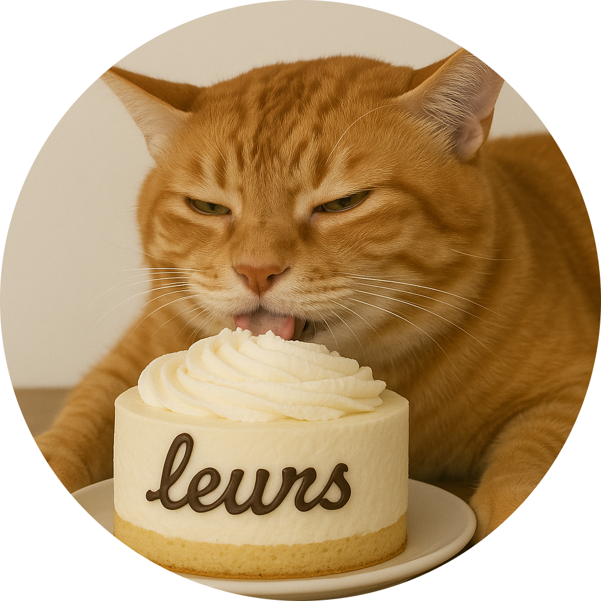

# <p align="center">leurs</p>

<p align="center">
  
</p>
<p align="center">
  <strong>A Discord bot with levels, economy, moderation and utility commands.</strong>
</p>
<p align="center">
  <a href="https://github.com/IM23d/leurs"></a>
  <a href="https://docs.leurs.ch/"></a>
  <a href="https://github.com/IM23d/leurs/blob/main/LICENSE"></a>
  <a href="https://github.com/IM23d/leurs/releases"></a>
</p>

## Features

- **Levels:** XP for messages and time in voice, ranks and leaderboards.
- **Economy:** coins, daily begging, jobs that pay out once a day, and coin-flip gambling.
- **Moderation:** warnings, bans, kicks, timeouts, jail, purge, blocked terms with automatic
  punishments, and a moderation log.
- **Roles:** temporary roles, reaction roles, and roles restored when a member rejoins.
- **Utility:** reminders, AFK, snipe, birthdays, timezones, weather, avatars, quote images and
  typing tests.
- **Integrations:** Last.fm now playing, AI answers and translation through DeepSeek, and Google
  image search.

Every command works as a slash command and with the server's prefix, which defaults to `-`. See
[docs/commands.md](docs/commands.md) for the full list.

## Running the bot

You need a Discord application with a bot user. In the Developer Portal, turn on the **Server
Members** and **Message Content** intents.

```bash
git clone https://github.com/IM23d/leurs.git
cd leurs
cp .env.example .env   # then fill in DISCORD_TOKEN and DISCORD_CLIENT_ID
```

### With Docker

```bash
npm ci                    # only needed once, for the next command
npm run deploy:commands   # registers the slash commands with Discord
docker compose up -d --build
```

The database lives in `./data/leurs.db`. `GET http://localhost:9992/health` returns 200 while the
bot is connected to Discord.

### On a server

CI publishes the image to `ghcr.io/im23d/leurs` after the checks pass. Every push to `v2` updates
the `latest` tag. On the server you only need `compose.yml`, `.env` and a `data` folder:

```bash
docker compose pull
docker compose run --rm leurs node scripts/deploy-commands.ts   # when commands changed
docker compose up -d
```

If the package on GitHub is private, log in first with a token that has `read:packages`:
`docker login ghcr.io -u <github-user>`.

### Without Docker

Needs Node.js 24 or newer.

```bash
npm ci
npm run deploy:commands
npm start
```

Run `npm run deploy:commands` again whenever a command changes.

## Configuration

All settings come from `.env`. See [.env.example](.env.example).

| Variable                             | Needed for                                                                          |
| ------------------------------------ | ----------------------------------------------------------------------------------- |
| `DISCORD_TOKEN`, `DISCORD_CLIENT_ID` | Always                                                                              |
| `DEV_GUILD_ID`                       | Optional. Registers commands in one test server only, where changes show up at once |
| `OWNER_IDS`                          | Owner-only commands such as `/usage`                                                |
| `LASTFM_API_KEY`                     | Last.fm commands                                                                    |
| `DEEPSEEK_API_KEY`                   | `/ai` and `/translate`                                                              |
| `GOOGLE_API_KEY`, `GOOGLE_CSE_ID`    | `/image`                                                                            |
| `HEALTH_PORT`                        | Optional. Port for `GET /health`, 9992 by default                                   |

Commands whose key is missing reply that the feature is not configured. Server admins set the
prefix, log channels and jail role with `/prefix` and `/settings`.

## Development

```bash
npm run dev     # restarts on file changes
npm run check   # typecheck, lint, format check, tests and unused-code check, same as CI
```

- [docs/architecture.md](docs/architecture.md) explains the folder layout, the rules ESLint
  enforces, and how to add a command or a module.
- After changing a `*.schema.ts` file, run `npm run db:generate` and commit the migration.
- After changing a command, run `npm run docs:commands`.
- [docs/v2-plan.md](docs/v2-plan.md) lists what changed from the Python bot, which is kept in
  `legacy/` until v2 replaces it.

## Contributing

1. Create a branch from `v2` (or `main` after the v2 release).
2. Make your change and run `npm run check`.
3. Open a pull request and fill in the checklist.

Commit messages follow [Conventional Commits](https://www.conventionalcommits.org/).

## Contributors

<table>
  <tr>
    <td align="center">
      <a href="https://github.com/bettercallmilan">
        
        <br /><sub><b>Milan</b></sub>
        <br /><sub>Lead Developer</sub>
      </a>
    </td>
    <td align="center">
      <a href="https://github.com/reazndev">
        
        <br /><sub><b>Reazn</b></sub>
        <br /><sub>Developer</sub>
      </a>
    </td>
    <td align="center">
      <a href="https://github.com/seakyy">
        
        <br /><sub><b>Seakyy</b></sub>
        <br /><sub>Developer</sub>
      </a>
    </td>
    <td align="center">
      <a href="https://github.com/lhilfiker">
        
        <br /><sub><b>lhilfiker</b></sub>
        <br /><sub>Contributor</sub>
      </a>
    </td>
    <td align="center">
      <a href="https://github.com/PianoNic">
        
        <br /><sub><b>PianoNic</b></sub>
        <br /><sub>Contributor</sub>
      </a>
    </td>
  </tr>
</table>

## License

MIT. See [LICENSE](LICENSE).
